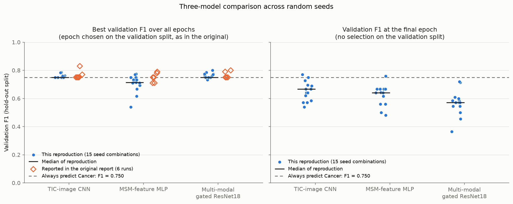
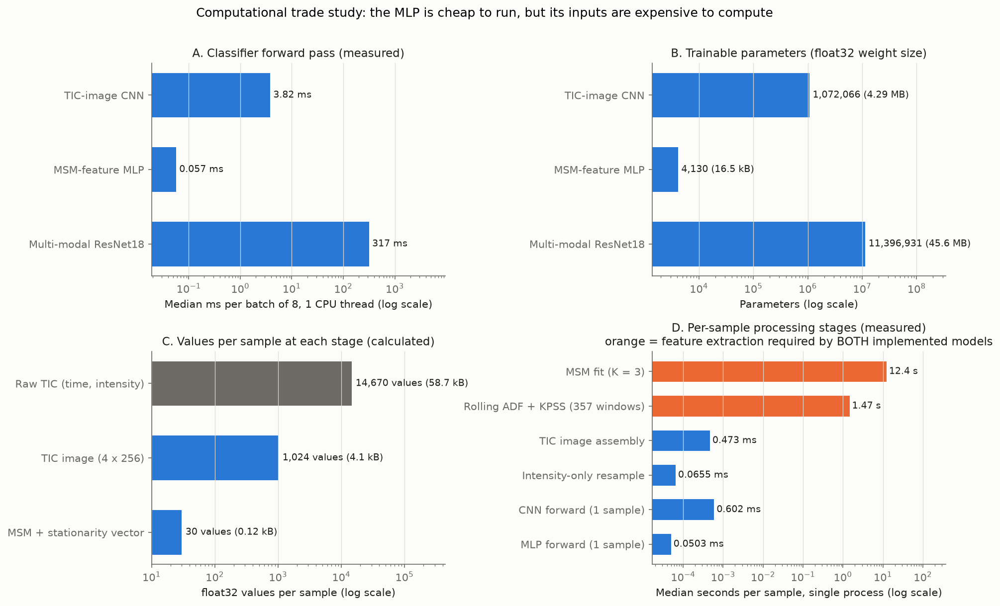
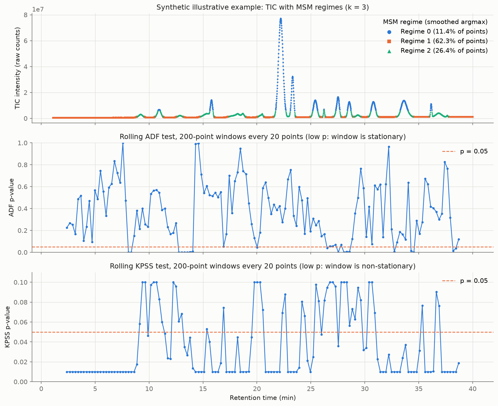
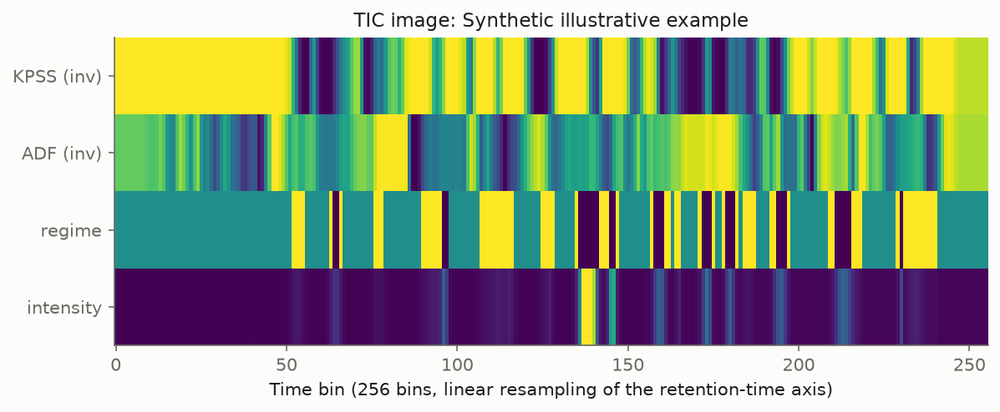
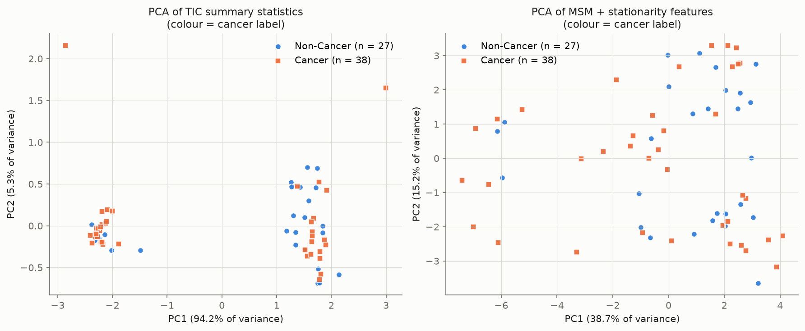
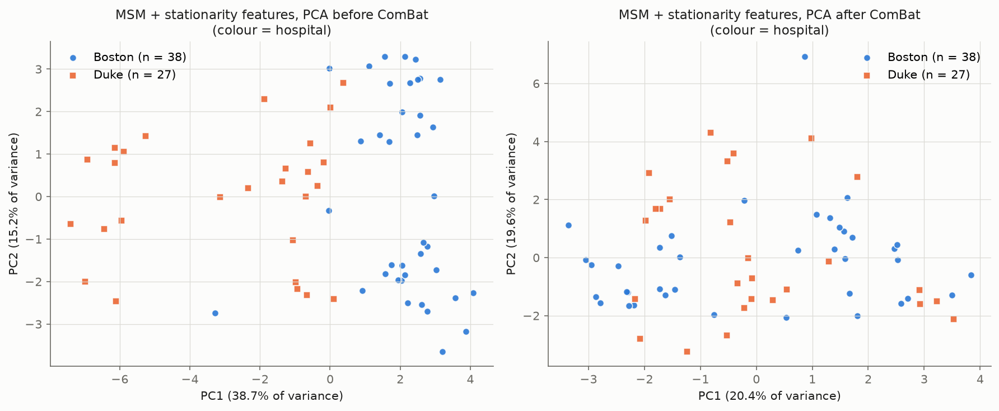
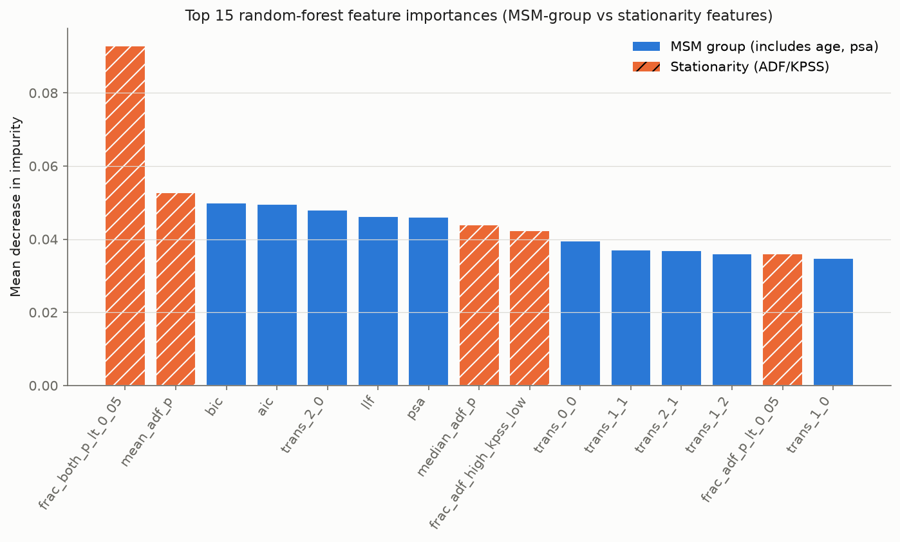
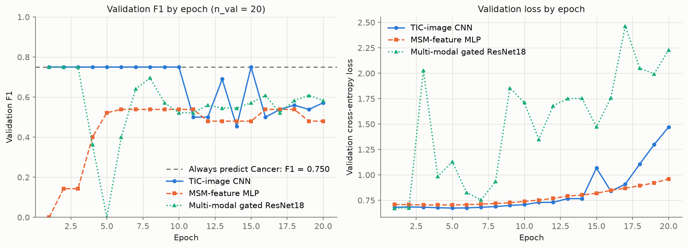

# MSM Olfactory Low-SWaP-C

**Markov-Switching and Stationarity Modeling for Resource-Constrained Machine Olfaction**

This project explores whether dynamic GC-MS signal features extracted with Markov Switching Models and stationarity
analysis can support a much smaller, lower-compute classifier while retaining performance in a range comparable to an
image-based CNN. The work is a proof of concept for resource-constrained machine-olfaction applications, not a
clinical diagnostic system.

**Portfolio takeaway:** This project demonstrates time-series modeling, feature engineering, statistical testing,
batch harmonization, neural-network comparison, multimodal modeling, reproducibility, and engineering trade-space
analysis for edge AI.

**Proof-of-concept question:** *Can Markov-switching and stationarity-derived features preserve comparable
classification performance while substantially reducing computational burden, making machine-olfaction approaches
more viable under SWaP-C constraints?*

Python 3.12 · statsmodels · scikit-learn · neuroCombat · PyTorch · pytest

> **Scope.** This is a feasibility study on a published research dataset: Rotteveel et al. (2025), 65 labelled
> samples from two sites, one 20-sample validation split. Results are exploratory and require additional validation.
> Nothing here is a clinical, diagnostic or operational claim.

---

> **Data.** No source data is included. The original model-input data is intentionally excluded, and users must
> obtain it independently from its original source (see [`data/README.md`](data/README.md)). No proprietary partner
> data is included.

## Engineering Objective

The long-term application context is **resource-constrained machine olfaction**: chemical sensing on small,
low-power devices where size, weight, power and cost (SWaP-C) limit the compute available for classification. Large
image models and GPU inference are difficult to field in that setting.

The purpose of this proof of concept was **not** to show that a Markov-switching approach outperforms a CNN. It was
to determine whether a **lower-dimensional dynamic signal representation** could **reduce computational
requirements** (model complexity, input size and inference burden) **without materially sacrificing
classification performance** relative to an image-based CNN on the same data.

That turns into two measurable questions:

1. **Performance retention.** Does an MLP on MSM + stationarity features reach F1 in a comparable range to the
   TIC-image CNN under the same protocol?
2. **Computational reduction.** How much smaller and faster is it, at the model level and end to end?

## Research motivation

Medical detection dogs can recognise prostate cancer from urine odour. Rotteveel et al. (2025) showed that a CNN
trained on GC-MS data, after removing strong site-specific batch effects, can learn some of that "scent character"
without identifying individual compounds. CNNs learn from **morphology**: where peaks are and how large they are.

This project represents the same signal by its **dynamics** instead: how the chromatogram switches between hidden
intensity regimes, how persistent those regimes are, and where it is locally stable or unstable. A 30-number dynamic
fingerprint can be classified by a model thousands of times smaller than an image network. That is the property that
matters for low-SWaP edge sensing, provided classification performance holds up.

## The GC-MS / TIC problem

Gas chromatography-mass spectrometry separates volatile compounds over about 40 minutes of retention time. The
**total ion chromatogram (TIC)** sums all ion counts at each time point, giving about 7,300 values per sample.
Raw TIC intensity is hard to model directly:

- **Dynamic range.** Counts span roughly 10^5 to 10^8, so a few dominant peaks swamp everything else.
- **Non-stationarity.** The baseline drifts, and noise and volatility change as compounds elute.
- **Batch effects.** Instrument, column and protocol differ by hospital. In this data, one principal component of
  simple intensity statistics explains 94% of their variance and tracks site and intensity scale, not disease.
- **Few labels.** Tens of labelled samples per site make high-capacity models easy to overfit.

## Technical approach

```
267 TICs + clinical metadata (Kaggle)
  ├─ transform        y = zscore(log1p(intensity))
  ├─ MSM              3-regime Markov switching regression per TIC → smoothed regimes, transition matrix
  ├─ stationarity     rolling ADF + KPSS (200-pt windows, step 20) → where the signal is stable or unstable
  ├─ features         28 dynamic features (+ age, PSA, as in the original) → 30-dim vector per sample
  ├─ harmonize        ComBat empirical Bayes, batch = hospital
  ├─ TIC image        4 × 256: intensity | regime | 1−p(ADF) | 1−p(KPSS)
  ├─ models           TIC-image CNN  ·  MSM-feature MLP  ·  gated multimodal ResNet18
  └─ evaluate         F1 vs a constant-classifier reference · seed study · latency / size / input trade study
```

**Markov switching model (MSM).** Each transformed TIC is modelled as
$y_t = \mu_{S_t} + \varepsilon_t$, with $\varepsilon_t \sim \mathcal N(0, \sigma^2)$ and a hidden regime
$S_t \in \{0, 1, 2\}$ that evolves as a Markov chain, $P(S_t = i \mid S_{t-1} = j) = p_{ij}$. The model is
statsmodels `MarkovRegression`, fitted by EM with 20 random starts. The regimes act as learned intensity bands
(baseline, intermediate, peak-dominated), and the transition matrix captures how persistent they are (median
diagonal 0.976). Features: regime occupancy, the 9 transition probabilities, and the log-likelihood, AIC and BIC.

**Stationarity analysis.** The two tests have opposite null hypotheses. The Augmented Dickey-Fuller test has
"unit root" as its null, so a low p-value means a window is stable. KPSS has "stationary" as its null, so a low
p-value means a window is unstable. Running both over 357 overlapping windows gives a stability profile of each run.
Features: fractions of windows below each threshold, the fraction where the two tests disagree, and mean and median
p-values.

**ComBat harmonization.** This is empirical Bayes location/scale adjustment of every feature by hospital, with the
cancer label as a protected covariate, as in the original analysis.

**TIC image representation.** Each sample becomes a 4 x 256 grayscale image. The four rows are resampled intensity,
MSM regime, $1-p_{ADF}$ and $1-p_{KPSS}$, each robustly scaled to [0, 1]. Three of the four rows encode dynamics, so
the "TIC" CNN also sees MSM and stationarity information.

**Three competing models.** All three use the same split and training settings: Adam, lr 1e-3, batch 8, 20 epochs.

| Model | Input | Architecture | Parameters |
|---|---|---|---|
| TIC-image CNN | 4 x 256 image | 3 conv layers + MLP head | 1,072,066 |
| MSM-feature MLP | 30 features | 30-64-32-2 MLP | 4,130 |
| Multimodal CNN | image + 30 features | ResNet18 (1-channel, on the image upsampled to 224 x 224) + feature MLP, fused by a learned scalar gate $g\,z_{img} + (1-g)\,z_{tab}$ | 11,396,931 |

## What the PoC Demonstrated

These are the defensible conclusions from the reconstructed experiments. Evidence and provenance are in
[`docs/results.md`](docs/results.md) and [`docs/swac_analysis.md`](docs/swac_analysis.md).

- **Compact representation.** MSM + stationarity features reduce each ~7,300-point chromatogram to a 30-value feature
  vector.
- **Overlapping performance ranges.** Across 15 reproduced seed combinations, the MSM-only MLP's F1 (0.54-0.77)
  overlapped the TIC-image CNN's (0.75-0.79); the original runs quoted 0.71-0.79 and 0.75-0.83. This is a
  comparable range under the tested protocol, not statistical equivalence or superiority
  ([what "comparable" means here](docs/results.md#what-comparable-means-here)).
- **Reduced model complexity.** The MSM-only model has 4,130 parameters against the CNN's 1,072,066: 260x fewer,
  16.5 kB against 4.3 MB of float32 weights.
- **Lower-dimensional input.** 30 inputs per sample against 1,024 for the CNN's image, 34x fewer.
- **Lower model-level inference burden.** The MSM-only forward pass was roughly 20x to 110x faster than the CNN's
  on CPU; the ratio varies between repeated measurements because the MLP runs in well under a millisecond.
- **End-to-end latency is still dominated by feature extraction.** Fitting the MSM and running the rolling
  stationarity tests takes about 14 s per sample in the current implementation, against under 1 ms for either
  classifier.
- **Therefore,** the concept is promising for SWaP-C optimization, but the feature-extraction pipeline must be
  optimized before claiming true end-to-end computational superiority.

Supporting observations: ComBat harmonization visibly reduced site-driven structure in the features (figure 07), and
gated image + feature fusion was feasible but not consistently better than either single model.

### What still requires validation

- **Performance retention above trivial levels.** On this split, a constant "always Cancer" prediction scores
  F1 = 0.750, inside the overlapping range. The experiments show that the MSM-only model stays in the CNN's range,
  but not yet that either model clearly exceeds that reference. That needs a larger, leakage-free evaluation
  (cross-validation, more sites, confidence intervals).
- **Stability.** With 20 validation samples, F1 moves by several hundredths between random seeds, so small
  differences between models are not meaningful.
- **End-to-end efficiency.** Faster regime estimation is needed (fewer random starts, warm starts, a streaming HMM
  filter), followed by latency and energy measurements on embedded hardware.
- **Generalisation.** Only two sites contribute labelled samples, and the original protocol fitted ComBat using the
  labels before the split.

## Experimental comparison



*Left: best validation F1 over 20 epochs, as reported in the original work. Filled dots are the 15 runs reproduced
here; hollow diamonds are the 6 runs quoted in the original report (report-only values); the dashed line is the F1
of always predicting Cancer. Right: F1 at the final epoch, without selecting on the validation set.*

| Model | Best val F1, median (range), 15 seed runs | Final-epoch F1, mean | Original report (6 runs) |
|---|---|---|---|
| TIC-image CNN | 0.750 (0.750-0.786) | 0.653 | 0.75-0.83 |
| MSM-feature MLP | 0.714 (0.538-0.774) | 0.623 | 0.71-0.79 |
| Multimodal gated ResNet18 | 0.750 (0.733-0.800) | 0.569 | 0.75-0.80 |
| *Always predict Cancer* | *0.750* | *0.750* | |

## Edge / SWaP-C trade space



- **Classifier stage.** All three models run on CPU without a GPU. The MLP (4,130 parameters, 0.05 ms per sample)
  is small enough for microcontroller-class memory. The CNN (about 0.6 ms per sample) and the multimodal network
  (about 49 ms per sample, 45.6 MB) are heavier.
- **Feature-extraction stage.** This is the real bottleneck: about 12.4 s for the MSM fit and 1.5 s for the rolling
  tests per sample on one desktop core. Fewer random starts, warm starts, a streaming HMM filter or simpler regime
  proxies would be needed before a dynamic-feature pipeline is genuinely edge-efficient.
- **Data movement.** 30 features (120 bytes) versus a 4 KB image matters only if features are computed at the
  sensor and transmitted. Either path must first process the full 59 KB raw TIC.

Full trade study, with every value marked measured, calculated or reported: [`docs/swac_analysis.md`](docs/swac_analysis.md).

## Visualizations

| | |
|---|---|
|  |  |
| **Synthetic illustrative example: MSM hidden regimes and stationarity.** A randomly generated chromatogram (not data, not a result) shows how the method works. Top: TIC coloured by smoothed regime. Middle and bottom: rolling ADF and KPSS p-values; the dashed line is p = 0.05. | **Synthetic illustrative example: multichannel TIC image.** Rows: intensity, MSM regime, 1−p(ADF) and 1−p(KPSS), each over 256 time bins: the input representation of the TIC-image CNN. |
|  |  |
| **Raw-TIC vs dynamic representation.** One component explains 94% of the variance in TIC intensity statistics; the 30 dynamic features spread variance across components. Neither separates the labels linearly. | **Batch harmonization.** Hospital clusters before ComBat (left) largely disappear afterwards (right). |
|  |  |
| **Feature importance (random forest).** The fraction of windows where ADF and KPSS disagree ranks first; stationarity features are hatched. This shows what the forest used, not validated predictive power. | **Training dynamics.** Validation F1 and loss per epoch against the always-Cancer reference; the models overfit 45 training samples within a few epochs. |

All figures are generated by `scripts/run_analysis.py`, `scripts/run_seed_study.py` and
`scripts/run_swap_analysis.py` (no screenshots). Figures 01, 02 and 04 are **synthetic illustrative examples** drawn from a randomly generated
chromatogram; they explain the method and are not experimental results. All other figures show aggregate
results. Sample-level chromatogram visualizations are intentionally excluded from the public repository. Public figures are limited to synthetic illustrative examples and aggregate analytical results.

## What I learned / engineering takeaways

- **Representation choice matters, and it has to be checked.** MSM and stationarity features turn a 7,300-point,
  batch-dominated signal into a compact, interpretable 30-number fingerprint. Whether that fingerprint is
  *discriminative* is a separate question, which this dataset could not settle.
- **Temporal dynamics capture information static morphology does not show.** The same chromatogram looks very
  different as regime and stability profiles (synthetic illustrations in figures 02 and 04). Interpretable structure is not the same as
  predictive signal, though, and the evaluation has to separate the two.
- **More model complexity did not buy performance.** An 11.4 M-parameter gated ResNet18 did no better than a
  4,130-parameter MLP or a constant prediction. With 45 training samples, capacity mainly buys overfitting.
- **Edge AI has to be judged on accuracy, latency, memory, bandwidth and compute together, end to end.** The MLP's
  much faster forward pass (up to about 100x) disappears once the 14 s of feature extraction it needs is counted. Measuring the whole
  path changed the conclusion.
- **Multimodal fusion needs careful normalization and architecture design.** A 512-D image embedding and a 30-D
  feature vector projected to a shared 128-D space, with one scalar gate, gave an unstable model. Vector gating,
  per-branch normalization and better-matched branch capacities are the obvious next steps.
- **Evaluation design is part of the model.** Seeding, constant-classifier references, final-epoch reporting and
  seed studies showed how much of a small-sample F1 is run-to-run variation. A proof of concept is only as strong as
  the protocol that tests it, and the next step here is a larger, leakage-free evaluation.

## Data

| Kind | Status |
|---|---|
| **Actual data:** Rotteveel et al. (2025), [Kaggle `adanrott/prostate-cancer-gc-ms-data`](https://www.kaggle.com/datasets/adanrott/prostate-cancer-gc-ms-data) | **Not included.** Download it and run `scripts/prepare_data.py` ([`data/README.md`](data/README.md)) |
| **Transformed data:** per-sample features, TIC images, fitted dynamics | Generated in `outputs/cache/`; not committed (contains per-sample clinical values) |
| **Results:** aggregate metrics, seed study, timings, importances | Committed in `outputs/results/` |
| **Synthetic demo data** | `--synthetic`: random, clearly labelled, only demonstrates that the software runs |

Only 65 of 267 chromatograms receive clinical labels, because El Paso and Virginia sample IDs are formatted
differently in the TIC folders and the metadata.

## Implementation

| Module | Responsibility |
|---|---|
| `config.py` | Filesystem paths, analytical constants and the `Settings` experiment configuration (defaults reproduce the original notebook) |
| `data.py` | Kaggle subset extraction, TIC and metadata loading with schema checks, sample-ID join |
| `preprocessing.py` | Shared log1p + z-score intensity transform |
| `msm.py` | `fit_markov_switching_model` (3 regimes, 2-regime fallback) and `extract_msm_features` |
| `stationarity.py` | `rolling_stationarity_tests` and `compute_stationarity_features` |
| `sample_dynamics.py` | Per-sample MSM + stationarity analysis: parallel, seeded, cached |
| `features.py` | Feature tables, the 30-column modelling matrix, tabular-baseline inputs |
| `images.py` | 4 x 256 multichannel TIC image |
| `batch_correction.py` | Standardisation, ComBat by hospital, PCA projections |
| `evaluation.py` | Shared stratified hold-out split, metrics, always-Cancer reference F1 |
| `tabular_models.py` | Logistic regression and random forest baselines, importances |
| `deep_models.py` | Dataset, the three PyTorch models, training and comparison, forward-pass timing |
| `benchmarking.py` | SWaP-C trade study: single-thread latency, feature-extraction timing, derived ratios |
| `visualization.py` | All figures |
| `pipeline.py` / `seed_study.py` | Orchestration of the analysis stages / the seed-sensitivity study |
| `reported.py` | Values quoted in the original report, with provenance (never presented as reproduced) |
| `synthetic.py`, `utils.py` | Labelled synthetic demo data; logging and JSON helpers |

Module responsibilities and data flow: [`docs/code_architecture.md`](docs/code_architecture.md).

## Software Engineering and Reproducibility

- **Modular Python package.** 19 focused modules with docstrings and type hints. The command-line scripts and the
  notebook call the same reusable functions, so there is one implementation, not notebook copies.
- **Automated tests.** 49 pytest tests cover data schema and error handling, MSM output shapes and transition-matrix
  orientation, stationarity calculations, model dimensions, the shared evaluation split, parallel-vs-serial
  equivalence, plotting, and an end-to-end synthetic run. No test needs the real data or a network connection.
- **Reproducible seeds.** Each sample's MSM start-value search, PyTorch initialisation and data shuffling are seeded.
  A full rerun from scratch reproduces every metric, feature table and training history bit for bit.
- **Executable notebook.** `notebooks/MSM_analysis.ipynb` runs end to end with the project environment.
- **Documented analytical provenance.** Each result is labelled reproduced, measured, calculated or report-only. Values
  quoted from the original report live only in `reported.py`, so they cannot be presented as reproduced.
- **Consistent style.** Code is linted and formatted with `ruff` (configuration in `pyproject.toml`).

## How to run (Windows, VS Code)

1. **Clone**

   ```powershell
   git clone https://github.com/aruzzo1/msm-olfactory-low-swap-c.git
   cd msm-olfactory-low-swap-c
   ```

2. **Create and activate a Python 3.12 virtual environment**

   ```powershell
   py -3.12 -m venv .venv          # if Python 3.12 is installed from python.org
   # or, with uv:  uv venv --python 3.12 .venv
   .\.venv\Scripts\Activate.ps1
   ```

   If PowerShell blocks the activation script, run `Set-ExecutionPolicy -Scope CurrentUser RemoteSigned` once.

3. **Install** (the CPU build of torch is about 200 MB)

   ```powershell
   python -m pip install --upgrade pip
   pip install -r requirements.txt
   pip install -e ".[dev]"     # the package plus ruff for linting
   ```

4. **Run the analysis**

   ```powershell
   # Real data: download the Kaggle archive first (see data/README.md)
   python scripts\prepare_data.py --zip path\to\prostate-cancer-gc-ms-data.zip
   python scripts\run_analysis.py --workers 8      # main pipeline, ~5 min
   python scripts\run_seed_study.py --workers 8    # 15-run seed study, ~15-20 min
   python scripts\run_swap_analysis.py             # computational trade study, ~2 min

   # Without the dataset (SYNTHETIC random data; scores are meaningless)
   python scripts\run_analysis.py --synthetic
   ```

5. **Notebook.** Open `notebooks/MSM_analysis.ipynb` in VS Code, choose **Select Kernel → Python Environments →
   .venv (Python 3.12)**, then **Run All**. It walks through one sample and reads the saved results.

6. **Tests and code quality** (tests take about 1 minute and use synthetic data only)

   ```powershell
   python -m pytest
   ruff check .
   ruff format --check .
   ```

## Repository structure

```
msm-olfactory-low-swap-c/
├── README.md
├── requirements.txt / pyproject.toml   runtime + test dependencies; ruff and pytest configuration
├── src/msm_olfactory/              the analysis package (see docs/code_architecture.md)
├── scripts/                            prepare_data · run_analysis · run_seed_study · run_swap_analysis
├── notebooks/MSM_analysis.ipynb        executed walkthrough
├── tests/                              49 unit, integration and smoke tests (synthetic data only)
├── data/README.md                      how to obtain the source data (no data is included)
├── outputs/figures/                    12 generated figures
├── outputs/results/                    run summary, seed study, SWaP-C timings, importances, training history
└── docs/
    ├── methodology.md                  full pipeline, code review, deviations, reproducibility
    ├── results.md                      reproduced vs report-only vs not-supported results
    ├── swac_analysis.md                computational (SWaP-C) trade study
    ├── code_architecture.md            modules and data flow
    └── project_background.md           relationship to Rotteveel et al. (2025)
```

## Limitations

- **Small, two-site sample.** 65 labelled samples, one 45/20 split, no external test set.
- **Optimistic protocol, inherited and reproduced deliberately.**
  - ComBat uses labels before the split (leakage).
  - Deep-model scores use the best epoch chosen on the validation set.
  - Age and PSA are among the "MSM" features.
  - The "TIC" image contains MSM and stationarity channels.
- **Model scope.** Regime numbers are arbitrary in each fit (label switching), and the MSM uses mean-only switching
  with a fixed K = 3.
- **Measurement scope.** Timings come from one workstation CPU, not embedded hardware, and energy was not measured.
- Full list, with fixes: [`docs/methodology.md` §9](docs/methodology.md#9-findings-from-the-code-review).

## Future work

- Leakage-free evaluation: repeated stratified or leave-one-site-out cross-validation, ComBat inside each fold,
  confidence intervals, constant-classifier baselines.
- Ablations: an intensity-only CNN; features without age and PSA; MSM-only against stationarity-only.
- Regime relabelling by fitted mean; K selection by BIC; switching variance.
- Recover the El Paso and Virginia labels (up to about 260 samples, four sites) after confirming the ID mapping.
- Cheaper regime estimation (fewer starts, streaming filters), then latency and energy on embedded hardware.
- Richer fusion: vector gating, per-branch normalization, cross-attention.

## Project background

This work began in December 2025 as an applied AI/data-science research notebook and technical report. It explored
an additional dynamic-signal representation, MSM and stationarity analysis, on top of the TIC-image approach of
Rotteveel et al. (2025). This repository reconstructs it as a reproducible portfolio implementation. The dataset and
the published study are the work of Rotteveel et al. See [`docs/project_background.md`](docs/project_background.md).

**Reference.** Rotteveel, A., Lee, W.-Y., Kountouri, Z., Stefanou, N., Kivell, H., Gluck, C., Zhang, S., & Mershin, A.
(2025). Towards robust medical machine olfaction: Debiasing GC-MS data enhances prostate cancer diagnosis from urine
volatiles. *PLoS ONE*, 20(5), e0314742. <https://www.ncbi.nlm.nih.gov/pmc/articles/PMC12124533/>

## Copyright

Copyright © 2026 Amelia Ruzzo. All rights reserved.

This repository is published as a professional portfolio. No open-source license is granted. The source dataset and the
published study it builds on belong to their respective authors (see References).
