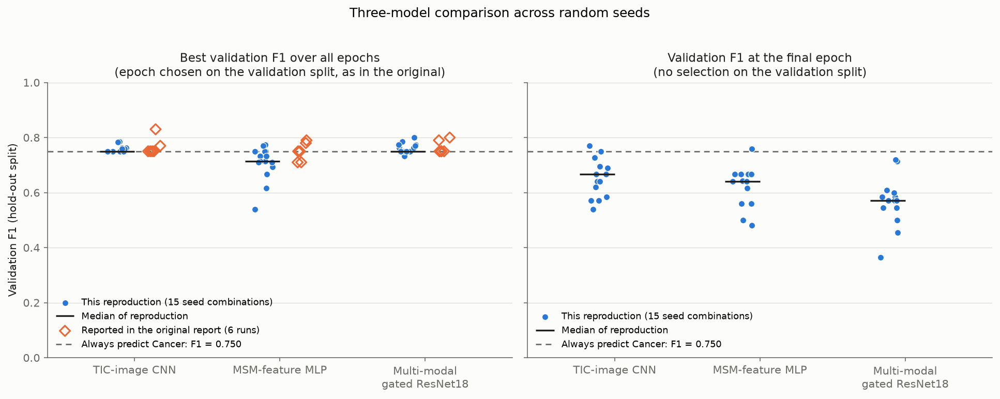

# Results

These are exploratory results on the public Rotteveel et al. (2025) GC-MS dataset: 65 labelled samples from two
sites, one 45/20 validation split. They are not clinical performance estimates.

Each result carries one of these labels:

| Label | Meaning |
|---|---|
| **Reproduced (exact)** | Recomputed by this repository and identical to the original notebook output |
| **Reproduced (in range)** | Recomputed here; depends on random seeds, and falls within the range of the original runs |
| **Reproduced (differs)** | Recomputed here with the same method, but numerically different, and the difference matters |
| **Report-only** | Stated in the original technical report, or found only in an earlier notebook version, and not independently reproduced here |
| **New** | Computed only in this reconstruction (not in the original work) |

Sources: the original notebook v18 HTML (authoritative for the implementation); the technical report "MSM Power
Evaluation on PCa Detection" v2 (Dec 2025); and earlier notebook versions v12-v17, which were checked only to trace
report values. Report values are collected, with their provenance, in
[`src/msm_olfactory/reported.py`](../src/msm_olfactory/reported.py).

## 1. Summary

| Claim in the original work | Status here |
|---|---|
| 267 TICs ingested and merged with metadata | **Reproduced (exact).** Only 65 receive labels (Boston, Duke); the report's "five clinical sites" and "full label coverage where available" overstate the labelled data |
| A 3-regime MSM segments each TIC into hidden regimes | **Reproduced (exact)** for the example sample: same optimum and statistics. Regime numbering differs between fits (label switching) |
| Raw-TIC summary PCA is dominated by one component (PC1 about 94%) | **Reproduced (exact):** 94.23% / 5.34% |
| MSM + stationarity PCA is richer (PC1 about 40%, PC2 about 15%) | **Reproduced (in range):** 38.7% / 15.2% |
| ComBat reduces hospital clustering | **Reproduced** qualitatively (figure 07), with the label-leakage caveat in §5 |
| `frac_both_p_lt_0_05` is the most important random-forest feature | **Reproduced:** rank 1 here, as in notebook v15 and v18. These importances describe a forest with validation ROC-AUC 0.27, so they are **not** evidence of predictive signal |
| Three-model F1: CNN 0.75-0.83, MLP 0.71-0.79, multi-modal 0.75-0.80 over six runs | **Reproduced (in range).** 15 seed combinations give CNN 0.750-0.786, MLP 0.538-0.774 and multi-modal 0.733-0.800, which overlap the reported ranges; the CNN's 0.83 appears only in notebook v12. Each model's median is at or below the always-Cancer F1 of 0.750 (§3) |
| MSM-only MLP "matches CNN performance" | **Reproduced as stated, but uninformative.** The two are similar, but both are at the level of a constant classifier |
| Multimodal fusion "can match or exceed" single models (F1 up to 0.80) | **Reproduced (in range):** 0.733-0.800; median 0.750 |
| Calibrated / balanced logistic regression: F1 0.786, ROC-AUC 0.677, PR-AUC 0.769 (report Step 11b2) | **Report-only.** Found in notebook v13-v15 outputs, not v18. Under the same method here: F1 0.400-0.727 and ROC-AUC 0.479-0.719 across MSM seeds (§4). The report attributes it to "MSM + stationarity" features, but it used MSM-group features plus age and PSA |
| CNN 13.5 ms vs MLP 0.29 ms per batch (47.5x) | **Report-only** for those values (notebook v13-v15). **Reproduced (in range)** as a classifier-only speedup of about 20x-110x across repeated measurements (see [`swac_analysis.md`](swac_analysis.md)) |
| Parameters 1.07 M vs 4,130 (260x); inputs 1,024 vs 30 (34x) | **Reproduced (exact)** |
| "Orders-of-magnitude reductions in latency" for the MSM approach | **Not supported end to end.** Feature extraction takes about 13.9 s per sample and is needed by both models (see [`swac_analysis.md`](swac_analysis.md)) |
| TIC-only CNN "reproduces Rotteveel et al. (F1 about 0.78)" | **Not supported.** The architecture, image, debiasing, data subset and evaluation all differ (§6) |

## What Comparable Means Here

The proof-of-concept question was whether MSM + stationarity features could **preserve comparable classification
performance** while reducing computational burden. In this repository, "comparable" has a deliberately narrow
meaning:

> **Comparable = overlapping experimental performance ranges under the tested protocol.**
> It does **not** mean statistical equivalence, and it does **not** mean superiority.

| Model | Best validation F1, 15 reproduced seed runs | Original report, 6 runs (report-only) |
|---|---|---|
| TIC-image CNN | 0.750 to 0.786 (median 0.750) | 0.75 to 0.83 |
| MSM-feature MLP | 0.538 to 0.774 (median 0.714) | 0.71 to 0.79 |
| Overlap | **0.750 to 0.774** | **0.75 to 0.79** |

What this does and does not establish:

- **It establishes** that, on the same data, split and training protocol, the 4,130-parameter MSM-only MLP produced
  F1 values inside the range spanned by the 1.07-million-parameter CNN. The smaller representation did not push
  performance outside the CNN's observed range.
- **It is not an equivalence test.** No equivalence margin was pre-specified, and with 20 validation samples a 95%
  bootstrap confidence interval on F1 is about ±0.16 to ±0.20 wide. That is far too wide to show that two models
  perform the same.
- **It is not a superiority claim** for either model. Their medians differ by 0.036, about what one validation
  sample changing class does to F1 (0.024 to 0.040).
- **It is a relative statement, not an absolute one.** On this split, predicting "Cancer" for every sample scores
  F1 = 0.750, which also lies inside the overlap. Comparable-range performance shows that the MSM path keeps pace
  with the CNN path. It does not yet show that either path clearly exceeds that reference. Establishing absolute
  performance retention is the main open validation task (§7).

A stronger test of comparability would use repeated or nested cross-validation with ComBat fitted inside each fold,
report confidence intervals and a constant-classifier baseline, and apply a pre-specified equivalence margin.

## 2. Exactly reproduced values

| Quantity | Original notebook (v18) | This repository |
|---|---|---|
| TICs; rows; rows without metadata | 267; 1,958,444; 1,481,669 | same |
| Labelled samples (Boston / Duke; Cancer / Non-Cancer) | 65 (38 / 27; 38 / 27) | same |
| Example sample: log-likelihood, AIC, BIC | -5378.631, 10777.262, 10846.266 | same |
| Example-sample stationarity summary (all 10 values) | e.g. `frac_both_p_lt_0_05` = 0.100840 | equal to 6 decimals |
| Example-sample rolling windows; KPSS p range | 357; [0.010, 0.100] | same |
| Image-panel samples (seeded random draw of 4 Cancer + 4 Non-Cancer) | 8 specific samples | the same 8 samples (IDs not published) |
| PCA of TIC summary statistics (PC1 / PC2) | 0.9423 / 0.0534 | same |
| Parameters (CNN / MLP); inputs (CNN / MLP) | 1,072,066 / 4,130; 1,024 / 30 | same |

## 3. Seed-sensitivity study

**New.** The same protocol (data, split, features, ComBat, architectures, 20 epochs) was repeated under 3 MSM
start-value seeds x 5 PyTorch seeds, giving 15 runs (`scripts/run_seed_study.py`, `outputs/results/seed_study.csv`).

| Model | Best val F1 over 20 epochs: median (range) | Runs above 0.750 | Median best epoch | Final-epoch (20) F1: mean (range) | Report (6 runs) *(report-only)* |
|---|---|---|---|---|---|
| TIC-image CNN | 0.750 (0.750-0.786) | 7 / 15 | 1 | 0.653 (0.538-0.769) | 0.75-0.83 |
| MSM-feature MLP | 0.714 (0.538-0.774) | 2 / 15 | 8 | 0.623 (0.480-0.759) | 0.71-0.79 |
| Multi-modal gated ResNet18 | 0.750 (0.733-0.800) | 7 / 15 | 2 | 0.569 (0.364-0.720) | 0.75-0.80 |
| *Always predict Cancer* | *0.750* | | | *0.750* | |

**Interpretation.**

- The original report's six-run F1 ranges are consistent with ordinary seed-to-seed variation under this protocol.
  They are **not** six independent experiments; they come from several notebook versions run with unseeded randomness.
- Where a model exceeds 0.750, it does so by at most 0.05, which is one or two of the 20 validation samples.
- The best-epoch score selects on the same 20 samples it reports, and the CNN and multi-modal models reach it at epoch
  1-2, before meaningful training. Without that selection (right panel), every model's mean F1 is below the constant
  classifier's.
- The MLP's median sits slightly below the constant classifier. The data do not support a ranking among the three
  models.

## 4. Tabular baselines

| Model | Original v18 run *(reported)* | Notebook v13-v15 / report Step 11b2 *(report-only)* | This repo, MSM seeds 42 / 7 / 2025 |
|---|---|---|---|
| LogReg, MSM-group features (incl. age, PSA): F1 | 0.667 | 0.786 | 0.545 / 0.727 / 0.400 |
| ... ROC-AUC | 0.667 | 0.677 | 0.490 / 0.719 / 0.479 |
| LogReg, all 26 non-constant features: F1 | 0.636 | 0.750 | 0.381 / 0.500 / 0.476 |
| ... ROC-AUC | 0.594 | 0.604 | 0.313 / 0.531 / 0.469 |
| Random forest, all features: F1 | 0.714 | 0.759 | 0.522 / 0.455 / 0.636 |
| ... ROC-AUC | 0.635 | 0.490 | 0.271 / 0.479 / 0.438 |

The report highlights the Step 11b2 result (F1 0.786, recall 0.92, PR-AUC 0.769) as "very strong evidence" that the
features encode diagnostic signal. Three points qualify that:

1. That result used the 17 MSM-group features, which include age and PSA, and **no stationarity features**. In the
   same notebook run, adding the stationarity features gave F1 0.750 and ROC-AUC 0.604.
2. Its confusion matrix ([[3, 5], [1, 11]]) differs from always predicting Cancer ([[0, 8], [0, 12]]) by three
   correctly rejected non-cancer samples at the cost of one missed cancer.
3. Re-deriving the features with different MSM seeds gives ROC-AUC between 0.48 and 0.72 for the same model. The
   result therefore depends on which local optimum each per-sample MSM reached.

PR-AUC should also be read against prevalence: with 12 positives in 20, a random ranking already gives a PR-AUC of
about 0.60.

## 5. PCA and ComBat

**Reproduced.** PCA of four TIC intensity statistics is dominated by one component (94.2%) that separates samples by
intensity scale rather than label (figure 06, left). PCA of the 30 standardized features spreads variance more
evenly: PC1 38.7%, PC2 15.2% (figure 06, right). Before ComBat the hospitals separate along PC1; afterwards they
overlap (figure 07).

Caveat: ComBat was fitted on all 65 samples **with the cancer label as a protected covariate**. Any label structure
that remains after correction (figure 08, and the report's "more coherent cancer-related structure") is partly built
in by that choice, and is not independent evidence.

## 6. Context: the published F1 of 0.78

Rotteveel et al. report F1 0.78 (recall 0.88, accuracy 0.75) under five-fold cross-validation on 365 samples from four
centres. They used a pretrained ResNet18, their own image representation, baseline-drift removal and
domain-adversarial training. The CNN here differs on every one of those points and is scored on one 20-sample split,
so the two numbers are not comparable. F1 also depends on prevalence: the published cohort had about 66% positives
(240 of 365), where a constant positive prediction would score F1 of about 0.79. The paper's 75% accuracy, compared
with a 66% majority rate, is the more informative of its metrics for that comparison.

## 7. What can and cannot be concluded

**Supported:**

- MSM regimes and rolling ADF/KPSS profiles give compact, interpretable descriptions of individual chromatograms
  (illustrated on a synthetic example in figures 01, 02 and 04).
- Hospital (batch) structure dominates the engineered features, and ComBat visibly reduces it.
- The MSM-feature MLP's forward pass is about 20x to 110x cheaper (range across repeated measurements) and the model is 260x smaller than
  the TIC-image CNN. This excludes feature extraction.
- Gated multimodal fusion is technically feasible.

**Not supported by these experiments:**

- That MSM + stationarity features carry reliable cancer-discriminative signal.
- That any of the three models outperforms a constant classifier, or that one model outperforms another.
- That the MSM approach reduces end-to-end computation as implemented.
- Any clinical, diagnostic or generalisation claim.

The question remains open rather than answered negatively. The protocol here is too small and too noisy to detect
modest signal. [`methodology.md` §9](methodology.md#9-findings-from-the-code-review) lists the changes that would make
a fair test possible.
