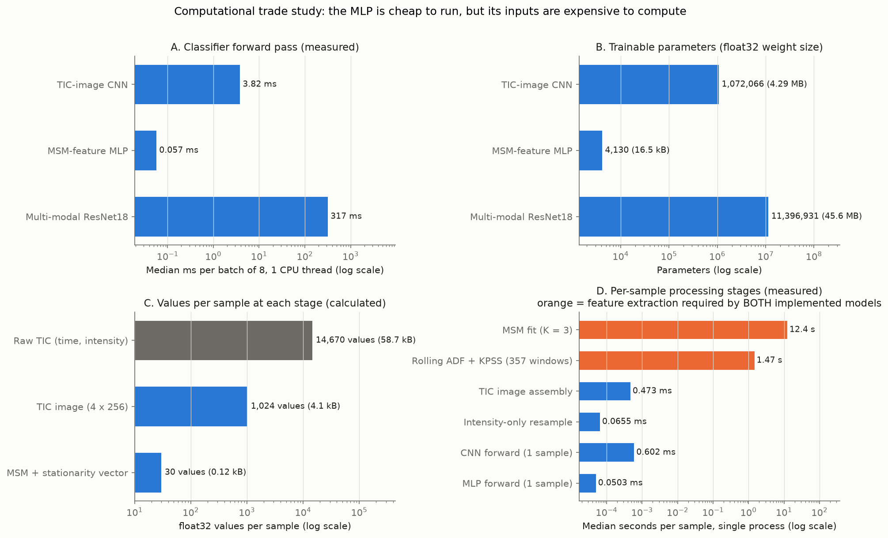

# Computational trade study (SWaP-C)

**Question.** Edge sensing devices are constrained in size, weight, power and cost (SWaP-C). Does a classifier on 30
dynamic features cost substantially less to run than a CNN on a TIC image, and what does the whole processing chain
cost?

**Evidence labels used in this document.**

- **Reproduced:** recomputed by this repository and identical to the value in the original notebook or report.
- **Measured:** timed in this repository.
- **Calculated:** derived arithmetically from model or data shapes, or from measured values.
- **Report-only:** stated in the original technical report or original notebook outputs, and not re-measured here.

Reproduce the measurements with `python scripts/run_swap_analysis.py`. They are written to
`outputs/results/swap_c_analysis.json` and `outputs/figures/12_swap_c_trade_study.png`.

## Summary: CNN path vs MSM path

"CNN path" is the TIC-image CNN as implemented: its 4 x 256 image contains intensity **plus** MSM-regime and ADF/KPSS
rows. "MSM path" is the MSM-feature MLP on the 30-value feature vector. Latencies are CPU only.

| Metric | CNN path | MSM path | Interpretation | Evidence type |
|---|---|---|---|---|
| Trainable parameters | 1,072,066 | 4,130 | 260x fewer parameters | Reproduced |
| Weight size (float32) | 4.29 MB | 16.5 kB | Fits microcontroller-class memory (qualitative) | Calculated |
| Classifier input dimensionality | 1,024 values (4 x 256) | 30 values | 34x fewer inputs | Reproduced |
| Classifier input size (float32) | 4.1 kB | 0.12 kB | Matters only if features are transmitted rather than computed on the device | Calculated |
| Inference latency, original report (batch of 8) | 13.5 ms | 0.29 ms | 47.5x, one notebook run on Colab CPU | Report-only |
| Inference latency, original notebook v16-v18 (batch of 8) | 6.5 to 8.9 ms | 0.24 to 0.25 ms | 27x to 35x | Report-only |
| Inference latency, this repo, original protocol (batch of 8) | 5.00 ms | 0.13 ms | 40x (20x to 40x over five runs) | Measured |
| Inference latency, this repo, 1 thread, median of 200 (batch of 8) | 3.82 ms | 0.057 ms | 67x (67x to 110x over three runs) | Measured |
| Inference latency per sample, 1 thread | 0.60 ms | 0.050 ms | Both well under 1 ms | Measured |
| Feature extraction per sample (MSM fit + rolling ADF/KPSS) | 13.9 s (needed for image rows 1-3) | 13.9 s (needed for the 30 features) | Dominates both paths; MSM fit alone is 12.4 s | Measured |
| Image assembly per sample | 0.47 ms | not needed | Negligible | Measured |
| **End-to-end latency per sample** | **13.89 s** | **13.89 s** | **No end-to-end difference as implemented** | Calculated (from measured stages) |
| End-to-end, hypothetical intensity-only CNN (resample + CNN) | about 0.7 ms | n/a | An image-only CNN would currently be far faster end to end; its accuracy was not evaluated here | Calculated (not implemented) |

**Bottom line.** At the **model level** the MSM path is much lighter: 260x fewer parameters, 34x fewer inputs and a
about 20x to 110x faster forward pass (range over repeated measurements). At the **pipeline level**, the current feature extraction (about 14 s per sample)
erases that advantage. A true end-to-end SWaP-C advantage therefore depends on optimizing MSM and stationarity
feature extraction, and has not been demonstrated yet.

## 1. Classifier forward-pass latency

| Model | Original report: ms / batch of 8 *(report-only)* | Original notebook v16-18 *(report-only)* | This repo, pipeline Step 19 *(measured)* | This repo, 1 thread, median of 200 *(measured)* |
|---|---|---|---|---|
| TIC-image CNN | 13.5 | 6.5 to 8.9 | 5.00 | **3.82** |
| MSM-feature MLP | 0.29 | 0.24 to 0.25 | 0.13 | **0.057** |
| Multi-modal gated ResNet18 | not measured | not measured | not measured | **317** |
| **Speedup, CNN / MLP** | **47.5x** | 27x to 35x | 40x (20x to 40x over five runs) | **67x** (67x to 110x over three runs) |

- **Original protocol (Step 19):** mean over the 3 validation batches, default PyTorch threading, Google Colab CPU.
  The speedup varied between 27x and 47.5x across notebook runs, and was 20x to 40x across five runs of the pipeline here.
  With only 3 timed batches, the ratio is dominated by timer noise and framework overhead.
- **This repository's protocol:** median of 200 repetitions on one CPU thread (a proxy for a single-core edge
  processor), on an Intel Xeon w5-3433 workstation. Batch of 8: CNN 3.82 ms, MLP 0.057 ms, multi-modal 317 ms. Batch of
  1: CNN 0.60 ms, MLP 0.050 ms, multi-modal 49 ms. Repeating the measurement on the same machine gave CNN/MLP
  ratios of 67x, 97x and 110x, because the MLP's sub-0.1 ms timings are close to the timer and framework overhead.
- **Conclusion (measured):** the MLP forward pass is one to two orders of magnitude cheaper than the CNN's, and about
  three to four orders of magnitude cheaper than the multi-modal model's. The exact ratio depends on hardware, threading and batch size, so
  report it as a range rather than one number.

## 2. Model size

| Model | Trainable parameters *(reproduced; equal to the report)* | float32 weights *(calculated)* |
|---|---|---|
| TIC-image CNN | 1,072,066 | 4.29 MB |
| MSM-feature MLP | 4,130 | 16.5 kB |
| Multi-modal gated ResNet18 | 11,396,931 | 45.6 MB |

**Reduction, CNN / MLP: 260x** (calculated; the report's "~260x" is reproduced exactly). A 16.5 kB model fits in the
SRAM of many microcontrollers; a 4.3 MB model generally needs external memory. That is a qualitative implication,
not a measurement on embedded hardware.

## 3. Input dimensionality and data movement

| Stage | Values per sample | float32 bytes *(calculated)* |
|---|---|---|
| Raw TIC (retention time, intensity), about 7,335 points | 14,670 | 58.7 kB |
| TIC image, 4 x 256 (CNN input) | 1,024 | 4.1 kB |
| MSM + stationarity feature vector (MLP input) | 30 | 0.12 kB |

**Reduction, CNN input / MLP input: 34x** (calculated; matches the report's "~34x"). This reduction applies to the
interface **between feature extraction and the classifier**. Both implemented pipelines must first acquire and
process the whole raw TIC on the device. Sensor-to-processor bandwidth only drops if feature extraction runs at the
sensor and only the 30 features are transmitted, for example to a remote classifier or as compressed telemetry.

## 4. The cost the original comparison omitted: feature extraction

Neither classifier sees raw data. The MLP's 30 inputs are MSM and ADF/KPSS statistics. Rows 1-3 of the CNN's
"TIC image" are the MSM regime and the ADF/KPSS p-value profiles. **Both implemented models therefore need the same
expensive preprocessing.**

| Stage, per sample, single process *(measured; median of 5 samples)* | Time |
|---|---|
| MSM fit (K = 3; EM plus 20 random starts) | 12.4 s (range 11.0 to 13.0 s) |
| Rolling ADF + KPSS (357 windows of 200 points) | 1.47 s |
| TIC-image assembly (resampling 4 rows) | 0.47 ms |
| Intensity-only resampling (what an intensity-only CNN would need) | 0.07 ms |
| CNN forward, 1 sample | 0.60 ms |
| MLP forward, 1 sample | 0.050 ms |

| End-to-end path per sample *(calculated from the measurements above)* | Time |
|---|---|
| MSM + ADF/KPSS + MLP | **13.89 s** |
| MSM + ADF/KPSS + image + CNN (as implemented) | **13.89 s** |
| Intensity-only resampling + CNN (hypothetical; not implemented or evaluated) | about 0.7 ms |

**What the measurements show.**

1. As implemented, the "lightweight" path and the CNN path cost the same per sample (within 0.01%). The MSM fit
   accounts for about 89% of that time.
2. The classifier-only advantage of the MLP is real, but the time it saves (about 0.55 ms per sample) is about
   0.004% of the end-to-end cost.
3. A dynamic-feature approach becomes a SWaP-C win only if feature extraction is made cheap. Options include fitting
   with fewer random starts or warm starts, a streaming or online HMM filter, a fixed-parameter Hamilton filter
   instead of a full refit, or simpler regime proxies. Any of these would need to be re-validated for accuracy.

The original report states that the MSM approach offers "orders-of-magnitude reductions in latency" and enables
"deployment on low-power, CPU-only hardware". That holds for the classifier stage only. It is not supported end to
end by this implementation, and this repository does not repeat it.

## 5. Accuracy alongside cost

A SWaP-C argument needs the accuracy to be retained, not just the cost reduced. In this dataset and protocol, neither
the CNN nor the MLP reliably beats a constant "always Cancer" classifier on the 20-sample validation split (see
[`results.md`](results.md)). The cost comparison is therefore a statement about computational footprint, **not**
evidence that a cheaper model preserves diagnostic performance.

## 6. Implications for CPU-only and edge inference

- **Classifier footprint:** an MLP of a few thousand parameters is trivially deployable on CPU-only hardware. A
  1-million-parameter CNN is also CPU-feasible: about 0.6 ms per sample on one desktop core. Neither needs a GPU.
- **Feature-extraction footprint:** about 14 s of single-core desktop CPU per sample is the binding constraint, and
  would be slower on embedded processors. For near-real-time use, that pipeline is what needs engineering.
- **Memory:** classifier weights range from 16.5 kB to 45.6 MB. Working memory for the MSM fit (7,335-point series,
  3 regimes) is small but was not profiled.
- **Not measured:** energy (joules per inference), embedded-hardware latency, and model quantization. These are the
  next measurements for a real SWaP-C assessment.
